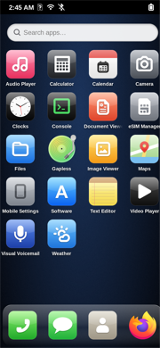

# ArctOS — mainline Linux на Redmi Note 8T (willow)

**ArctOS** — кастомная мобильная Linux-система для **Xiaomi Redmi Note 8T (willow, SM6125 / Snapdragon 665)**
на **mainline-ядре Linux 7.2** и **postmarketOS**, с оболочкой Phosh, переделанной под интерфейс в стиле iPhone 4 / iOS 4–6.

Здесь всё, что нужно, чтобы повторить: патчи ядра и DTS, портированные драйверы, патчи Phosh,
конфиги системы, тема и пошаговая инструкция с разбором типичных граблей.

> English summary: mainline Linux 7.2 (postmarketOS / sm61x5-mainline) bring-up for the Xiaomi Redmi Note 8T
> (willow, SM6125): real DPU/DSI display with DCS backlight, Novatek NT36672A SPI touch, Adreno 610 GPU,
> CPU frequency scaling, battery gauge, WCN3990 Wi-Fi (connects), Bluetooth, ADSP sensors / auto-rotate,
> modem + IPA. Plus "ArctOS": a patched Phosh with an iOS-4-like paged home screen. Step-by-step guide in
> [docs/INSTALL.md](docs/INSTALL.md).

## Что работает

| Подсистема | Статус | Как сделано |
|---|---|---|
| Загрузка, eMMC, USB-сеть, SSH | ✅ | DTB: board-id, регулятор l15, MDSS без сброса; пустой dtbo |
| Дисплей 1080×2340@60 (DPU→DSI) | ✅ | свой драйвер панели Tianma NT36672A, правки DPU для video-mode |
| Яркость / гашение экрана | ✅ | подсветка через DCS 0x51 (8 бит) в драйвере панели |
| Сенсор (Novatek NT36672A, SPI) | ✅ | порт драйвера из Android как модуль ядра |
| GPU Adreno 610 | ✅ | узлы GPU + zap-прошивка с устройства + SQE из linux-firmware |
| Частота CPU | ✅ | узел OSM `cpufreq@f521000` |
| Индикатор батареи | ✅ | минимальный драйвер PMI632 QG (из ginkgo-mainline) |
| Wi-Fi WCN3990 (2.4/5 ГГц) | ✅ | модем (MPSS) + pd-mapper + патчи ath10k для WLAN.HL.3.x |
| Bluetooth | ✅ | UART SE9 + `qcom,wcn3990-bt` (пока без патча прошивки контроллера) |
| Датчики, автоповорот | ✅ | ADSP + FastRPC + hexagonrpcd/libssc + iio-sensor-proxy |
| Модем (QMI/IPA) | ✅ виден в ModemManager | IPA v4.2 как у SC7180; звонки/SMS не проверялись (не было SIM) |
| Звук | ❌ | не делалось |
| Камера | ❌ | нет драйвера CAMSS для SM6125 в mainline |

## ArctOS (интерфейс)

Патченный **Phosh 0.57**: страницы иконок 4×5 с листанием вбок и точками-индикатором, док снизу,
автовход по PIN, всегда видимая кнопка ✕ и принудительное закрытие «зависших» приложений,
отдельные обои экрана блокировки, приложение «Обои», тема иконок в стиле iOS 4–6
(оригинальная графика, не иконки Apple).

## Документация

| Файл | Что внутри |
|---|---|
| [docs/INSTALL.md](docs/INSTALL.md) | **Рабочий метод по шагам**: от разблокированного загрузчика до ArctOS |
| [docs/FILES.md](docs/FILES.md) | Что откуда взято и куда кладётся (каждый файл) |
| [docs/BACK-TO-ANDROID.md](docs/BACK-TO-ANDROID.md) | Как вернуть Android (LineageOS) и грабли при этом |
| [docs/CREDITS.md](docs/CREDITS.md) | На чём основано, лицензии |

## Основа

Проект стоит на плечах:

- **[ginkgo-mainline-linux](https://github.com/Huabin1010/ginkgo-mainline-linux)** — mainline Linux на
  Redmi Note 8 (ginkgo, тот же SoC и та же панель/тачскрин). Их отчёты по дисплею, тачскрину, Wi-Fi и GPU
  были главной картой; драйвер PMI632 QG взят оттуда.
- **[postmarketOS](https://postmarketos.org/)** и ядро **[sm61x5-mainline](https://codeberg.org/sm61x5-mainline/linux)**
  (`linux-nura-qcom-sm61x5` 7.2.3).
- **[Phosh](https://gitlab.gnome.org/World/Phosh/phosh)** — мобильная оболочка, которую мы патчили.

## Важно

- Нужен **разблокированный загрузчик** (официально, через Mi Unlock). Этот репозиторий не описывает и не
  поддерживает обход разблокировки.
- Проприетарные прошивки (модем, ADSP, GPU zap, тачскрин, BT) **не распространяются** — их нужно достать из
  разделов своего же телефона, как описано в INSTALL.md.
- Всё делается на свой страх и риск. Сделайте бэкап.

---

**Ключевые слова:** Redmi Note 8T Linux, перепрошивка Redmi Note 8T, willow postmarketOS, mainline Linux
Redmi Note 8T, Xiaomi willow mainline kernel, SM6125 Linux, Snapdragon 665 Linux, ginkgo willow pmOS,
Phosh Redmi Note 8T, кастомная прошивка Redmi Note 8T, Linux на телефон Xiaomi, разблокировка загрузчика
Redmi Note 8T (Mi Unlock), LineageOS Redmi Note 8T, Redmi Note 8 ginkgo Linux, NT36672A mainline,
WCN3990 ath10k SM6125, Adreno 610 freedreno, ArctOS.
